<p align="center">
  <picture>
    <source media="(prefers-color-scheme: dark)" srcset="assets/readme-card-dark.svg">
    <source media="(prefers-color-scheme: light)" srcset="assets/readme-card-light.svg">
    
  </picture>
</p>

<p align="center">
  <a href="https://github.com/Agent007repo"></a>
  
</p>

# Recurrent Text Generation in Shakespearean Style

A PyTorch notebook for autoregressive subword text generation. A configuration selects a vanilla RNN, LSTM or GRU, BPE or WordPiece tokenization, model size, gradient clipping and decoding settings. One execution trains the configured model. A controlled comparison across models needs separate runs.

## Results

Old notebook outputs were removed, because overlapping randomly divided windows leaked corpus context across training and validation. This repository does not currently report a corrected perplexity, an architecture comparison, energy use or inference speed. Treat the notebook as an implementation experiment rather than a validated language-model benchmark.

The notebook reports validation cross-entropy and perplexity, with qualitative generated samples, once it is run on a full corpus.

## How it works

- **Split:** the raw corpus is divided into disjoint training and validation text before tokenizer training.
- **Tokenize:** BPE or WordPiece tokenizer caches are keyed by a digest of the training corpus.
- **Window:** sliding windows are built lazily within each partition, and each independent minibatch starts with a fresh recurrent state.
- **Train:** unidirectional models keep causal next-token prediction. Bidirectional configurations are rejected.
- **Decode:** temperature sampling uses stable probabilities and needs a finite positive temperature. Beam search and sampling consume the prompt exactly once.

Optional stemming needs NLTK resources. Without them, the notebook falls back to unstemmed text. Install the resources explicitly if you need stemming.

## Run it

Use Python 3.11 or newer. Install `requirements.txt` and place a UTF-8 `shakespeare.txt` in this directory. The notebook can also prompt for a Colab upload if the file is absent. Run the notebook from the repository root.

```bash
pip install -r requirements.txt
jupyter notebook Prof_Faith_Text_Generation_with_RNNs.ipynb
```

Tests:

```bash
python -m unittest discover -s tests -p test_regressions.py -v
```

## Honest scope

- **Leakage fixed, results not regenerated:** the split is now disjoint, but no corrected full-corpus run has been reproduced.
- **Synthetic tests:** the six regression tests train and evaluate the three small recurrent models on a synthetic tokenizer. They check a partial final batch, lazy targets, invalid configurations and stable decoding. They do not replace a full corpus run.
- **Out of scope:** energy consumption and inference efficiency have not been measured.

<p align="center"><sub>Part of <a href="https://github.com/Agent007repo">Samarth Annigeri's portfolio</a></sub></p>
